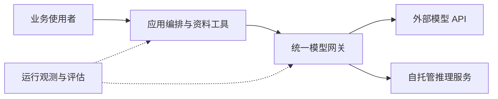

# 大模型聚合平台路线研究

更新日期：2026-11-27。收录 15 个 GitHub 项目，按网关、模型服务及应用与观测分组。每项提供仓库链接、设计阅读方向、源码入口、许可范围与核验快照，方便按目标研究。

内容由 AI 辅助整理，研究提示为原创归纳；证据来自各项目自己的 README、许可文件及源码。默认分支快照用于回看本次资料，不等同于稳定发行版；未安装、部署或执行性能、安全测试。本合集只整理链接与说明，没有复制第三方实现，也不代表数眼智能采用了这些项目。

## 从你想解决的问题开始

| 当前目标 | 先看哪组 | 应先弄清的边界 |
| --- | --- | --- |
| 已有多家模型 API，想统一接入 | A：网关与接入 | 网关代码与上游模型服务的授权、费用分别确认 |
| 希望运行自己的模型服务 | B：推理与部署 | 框架、模型权重、算力与运行维护各有条件 |
| 希望把材料变成可用应用 | C：应用与资料处理 | 编排框架、知识处理和工具适配承担不同工作 |
| 希望看清调用与评估记录 | C 中的 Langfuse | 记录如何关联、敏感内容如何处理需要另外设计 |
| 只是准备试用现成平台 | [今天的数眼智能使用者文章](../articles/2026-11-27-shuyanai-user-open-source-boundaries.md) | 先核对实际可用服务，不必把 15 个项目全部部署 |

各层可以组合。下面的示意图表达应用侧研究分工，不是数眼智能内部架构：

## 项目速查

| 项目 | 研究方向 | 本次许可摘要 |
| --- | --- | --- |
| [LiteLLM](https://github.com/BerriAI/litellm) | 沿着统一请求进入提供商适配、路由和代理服务的路径，研究公共请求与供应商差异怎样隔离。 | 核心适用根文件中的 MIT；litellm/enterprise/ 单独适用企业许可，不能将整库及企业功能概括为纯 MIT。 |
| [One API](https://github.com/songquanpeng/one-api) | 研究渠道配置、请求适配与令牌额度之间的分工，观察模型映射如何影响请求字段。 | 根 LICENSE 为 MIT；README 另写页面底部署名及项目链接要求，采用时应同时核对，本文不替使用者解释二者关系。 |
| [New API](https://github.com/QuantumNous/new-api) | 从 RelayKit 的转换质量与诊断结果研究跨协议转换，区分格式可转与语义完整保留。 | 根 LICENSE 为 AGPLv3；README 另列 Section 7 署名及可见原项目链接要求，并有 NOTICE 与第三方许可清单，不能按 MIT 项目处理。 |
| [Portkey AI Gateway](https://github.com/Portkey-AI/gateway) | 研究提供商适配与请求处理中间层怎样分开，让路由配置不直接散落到业务代码。 | 本次 main 快照根 LICENSE 为 MIT；README 将部分能力标为托管或企业版，不能把整套云产品等同于本仓库许可范围。 |
| [Bifrost](https://github.com/maximhq/bifrost) | 研究 core/providers、transports 与 plugins 的分层，判断核心模型调用怎样与HTTP和治理扩展解耦。 | 本次仓库根 LICENSE 为 Apache-2.0；README 同时区分企业部署能力，应以实际目录、版本及所购服务确认范围。 |
| [Higress](https://github.com/higress-group/higress) | 从AI Proxy插件的供应商映射与协议处理，研究模型适配怎样放进已有网关的数据路径。 | 本次仓库根 LICENSE 为 Apache-2.0；引用其他插件、子模块和镜像时仍须核对对应组件的许可。 |
| [vLLM](https://github.com/vllm-project/vllm) | 沿 API 服务启动、EngineClient 与 HTTP 应用初始化阅读，理解接口层与推理执行层的分工。 | Apache-2.0 |
| [SGLang](https://github.com/sgl-project/sglang) | 从 Scheduler 阅读请求批次、并行 worker 与运行循环之间的衔接，理解模型服务内部的调度职责。 | Apache-2.0 |
| [BentoML](https://github.com/bentoml/BentoML) | 从 service 装饰器和 Service 对象出发，对照 README 的打包流程，研究代码、依赖、模型配置如何形成服务交付物。 | Apache-2.0 |
| [Ray / Ray Serve](https://github.com/ray-project/ray) | 结合 Serve 的 deployment 目标状态、副本生命周期与健康检查阅读，研究服务状态如何由控制逻辑逐步实现。 | Apache-2.0 |
| [Ollama](https://github.com/ollama/ollama) | 从 routes.go 的请求处理与 runner 调度衔接入手，区分 HTTP 输入、模型选择和执行资源。 | MIT |
| [LangGraph](https://github.com/langchain-ai/langgraph) | 从 StateGraph 的状态、节点和编译过程研究应用如何组织执行；再看中断与持久化怎样接到业务确认步骤。 | MIT（根目录 LICENSE） |
| [RAGFlow](https://github.com/infiniflow/ragflow) | 研究原始材料经过 ingestion 后怎样进入检索与引用流程，区分文件接收、索引和答案依据。 | Apache-2.0（根目录 LICENSE） |
| [Langfuse](https://github.com/langfuse/langfuse) | 从 OTLP 数据进入后台处理的入口研究追踪记录与评估的衔接，明确业务任务和单次模型调用怎样关联。 | 核心 MIT Expat；指定 ee 目录另适用 Enterprise 许可 |
| [DataEyes MCP Server](https://github.com/dataeyesai/dataeyes-mcp-server) | 研究 search/read 参数如何进入统一 HTTP 请求封装，再看远端错误如何返回工具调用方。 | MIT（该工具适配仓库） |

许可摘要仅对应下文所链版本与范围。MIT、Apache、AGPL 及企业目录的条件不同；上游 API、模型权重、第三方组件与云产品不能由框架根许可统一代替。具体声明请点每项的许可与 README，复制、改动或部署前按所选内容确认。

## A：统一模型接入与网关

### LiteLLM

- 仓库：[LiteLLM](https://github.com/BerriAI/litellm)；默认分支 `main`，本次快照 [`c83b3a5e1da3`](https://github.com/BerriAI/litellm/commit/c83b3a5e1da3efb6bee34906cdb6acc186fc8acd)。
- 做什么：把多家模型服务接入同一套调用接口，可作为SDK使用，也可部署代理网关。
- 研究什么：沿着统一请求进入提供商适配、路由和代理服务的路径，研究公共请求与供应商差异怎样隔离。
- 从哪里读：[路由入口](https://github.com/BerriAI/litellm/blob/c83b3a5e1da3efb6bee34906cdb6acc186fc8acd/litellm/router.py) → [代理目录](https://github.com/BerriAI/litellm/tree/c83b3a5e1da3efb6bee34906cdb6acc186fc8acd/litellm/proxy)。
- 许可范围：核心适用根文件中的 MIT；litellm/enterprise/ 单独适用企业许可，不能将整库及企业功能概括为纯 MIT。 依据：[许可/声明1](https://github.com/BerriAI/litellm/blob/c83b3a5e1da3efb6bee34906cdb6acc186fc8acd/LICENSE)、[许可/声明2](https://github.com/BerriAI/litellm/blob/c83b3a5e1da3efb6bee34906cdb6acc186fc8acd/litellm/enterprise/LICENSE.md)；[README](https://github.com/BerriAI/litellm/blob/c83b3a5e1da3efb6bee34906cdb6acc186fc8acd/README.md)。
- 边界：仍需合法的上游服务凭证与运营安排；开源核心不等于免费上游或全部企业能力。企业目录生产使用另有许可条件。

### One API

- 仓库：[One API](https://github.com/songquanpeng/one-api)；默认分支 `main`，本次快照 [`8df4a2670b98`](https://github.com/songquanpeng/one-api/commit/8df4a2670b98266bd287c698243fff327d9748cf)。
- 做什么：提供模型API管理与渠道分发，并包含令牌、分组和额度等管理功能。
- 研究什么：研究渠道配置、请求适配与令牌额度之间的分工，观察模型映射如何影响请求字段。
- 从哪里读：[渠道适配目录](https://github.com/songquanpeng/one-api/tree/8df4a2670b98266bd287c698243fff327d9748cf/relay/adaptor) → [管理API说明](https://github.com/songquanpeng/one-api/blob/8df4a2670b98266bd287c698243fff327d9748cf/docs/API.md)。
- 许可范围：根 LICENSE 为 MIT；README 另写页面底部署名及项目链接要求，采用时应同时核对，本文不替使用者解释二者关系。 依据：[许可/声明1](https://github.com/songquanpeng/one-api/blob/8df4a2670b98266bd287c698243fff327d9748cf/LICENSE)；[README](https://github.com/songquanpeng/one-api/blob/8df4a2670b98266bd287c698243fff327d9748cf/README.md)。
- 边界：它管理和转发已获授权的上游调用，不提供模型权重或自动取得上游使用权；默认分支快照不能代表所有新模型都已适配。

### New API

- 仓库：[New API](https://github.com/QuantumNous/new-api)；默认分支 `main`，本次快照 [`81c1fd20efad`](https://github.com/QuantumNous/new-api/commit/81c1fd20efade39a5d5692c8018dfef4cfb30e1d)。
- 做什么：以自托管网关统一多种模型协议，并管理路由、访问、用量与成本记录。
- 研究什么：从 RelayKit 的转换质量与诊断结果研究跨协议转换，区分格式可转与语义完整保留。
- 从哪里读：[协议转换模块说明](https://github.com/QuantumNous/new-api/blob/81c1fd20efade39a5d5692c8018dfef4cfb30e1d/relaykit/README.md) → [上游适配目录](https://github.com/QuantumNous/new-api/tree/81c1fd20efade39a5d5692c8018dfef4cfb30e1d/relay)。
- 许可范围：根 LICENSE 为 AGPLv3；README 另列 Section 7 署名及可见原项目链接要求，并有 NOTICE 与第三方许可清单，不能按 MIT 项目处理。 依据：[许可/声明1](https://github.com/QuantumNous/new-api/blob/81c1fd20efade39a5d5692c8018dfef4cfb30e1d/LICENSE)、[许可/声明2](https://github.com/QuantumNous/new-api/blob/81c1fd20efade39a5d5692c8018dfef4cfb30e1d/NOTICE)、[许可/声明3](https://github.com/QuantumNous/new-api/blob/81c1fd20efade39a5d5692c8018dfef4cfb30e1d/THIRD-PARTY-LICENSES.md)；[README](https://github.com/QuantumNous/new-api/blob/81c1fd20efade39a5d5692c8018dfef4cfb30e1d/README.md)。
- 边界：转换模块不负责HTTP收发、渠道选择、鉴权和计费；不同协议的工具与字段可能无法等价转换。

### Portkey AI Gateway

- 仓库：[Portkey AI Gateway](https://github.com/Portkey-AI/gateway)；默认分支 `main`，本次快照 [`669825cbe89e`](https://github.com/Portkey-AI/gateway/commit/669825cbe89ee51569918b8f78a9db486fd69dd4)。
- 做什么：提供统一模型网关，可通过配置组织路由、重试和回退等请求行为。
- 研究什么：研究提供商适配与请求处理中间层怎样分开，让路由配置不直接散落到业务代码。
- 从哪里读：[提供商适配目录](https://github.com/Portkey-AI/gateway/tree/669825cbe89ee51569918b8f78a9db486fd69dd4/src/providers) → [请求中间层](https://github.com/Portkey-AI/gateway/tree/669825cbe89ee51569918b8f78a9db486fd69dd4/src/middlewares)。
- 许可范围：本次 main 快照根 LICENSE 为 MIT；README 将部分能力标为托管或企业版，不能把整套云产品等同于本仓库许可范围。 依据：[许可/声明1](https://github.com/Portkey-AI/gateway/blob/669825cbe89ee51569918b8f78a9db486fd69dd4/LICENSE)；[README](https://github.com/Portkey-AI/gateway/blob/669825cbe89ee51569918b8f78a9db486fd69dd4/README.md)。
- 边界：README 将 2.0.0 标为预发布分支，本条基于 main 快照；版本路线、托管产品和企业能力需分别核对。

### Bifrost

- 仓库：[Bifrost](https://github.com/maximhq/bifrost)；默认分支 `dev`，本次快照 [`ba7fc6173024`](https://github.com/maximhq/bifrost/commit/ba7fc6173024b85731cc082b8d435fc37f247d68)。
- 做什么：以Go核心、HTTP传输层与插件组织多提供商模型接入。
- 研究什么：研究 core/providers、transports 与 plugins 的分层，判断核心模型调用怎样与HTTP和治理扩展解耦。
- 从哪里读：[提供商核心](https://github.com/maximhq/bifrost/tree/ba7fc6173024b85731cc082b8d435fc37f247d68/core/providers) → [HTTP与其他传输层](https://github.com/maximhq/bifrost/tree/ba7fc6173024b85731cc082b8d435fc37f247d68/transports) → [插件目录](https://github.com/maximhq/bifrost/tree/ba7fc6173024b85731cc082b8d435fc37f247d68/plugins)。
- 许可范围：本次仓库根 LICENSE 为 Apache-2.0；README 同时区分企业部署能力，应以实际目录、版本及所购服务确认范围。 依据：[许可/声明1](https://github.com/maximhq/bifrost/blob/ba7fc6173024b85731cc082b8d435fc37f247d68/LICENSE)；[README](https://github.com/maximhq/bifrost/blob/ba7fc6173024b85731cc082b8d435fc37f247d68/README.md)。
- 边界：本次默认分支为 dev，是研究快照，不代替稳定发行版评估；README 的性能和不中断宣传未由本文复测，不能作为服务承诺。

### Higress

- 仓库：[Higress](https://github.com/higress-group/higress)；默认分支 `main`，本次快照 [`1c811c054071`](https://github.com/higress-group/higress/commit/1c811c054071654205d67c0b85092e3ddda6682b)。
- 做什么：基于Istio与Envoy的云原生API网关，通过Wasm插件扩展模型代理和其他接口能力。
- 研究什么：从AI Proxy插件的供应商映射与协议处理，研究模型适配怎样放进已有网关的数据路径。
- 从哪里读：[AI Proxy说明](https://github.com/higress-group/higress/blob/1c811c054071654205d67c0b85092e3ddda6682b/plugins/wasm-go/extensions/ai-proxy/README_EN.md) → [供应商适配目录](https://github.com/higress-group/higress/tree/1c811c054071654205d67c0b85092e3ddda6682b/plugins/wasm-go/extensions/ai-proxy/provider)。
- 许可范围：本次仓库根 LICENSE 为 Apache-2.0；引用其他插件、子模块和镜像时仍须核对对应组件的许可。 依据：[许可/声明1](https://github.com/higress-group/higress/blob/1c811c054071654205d67c0b85092e3ddda6682b/LICENSE)；[README](https://github.com/higress-group/higress/blob/1c811c054071654205d67c0b85092e3ddda6682b/README.md)。
- 边界：旧 alibaba/higress 地址现迁至 higress-group/higress，同仓库ID；网关插件并不自带模型算力、完整业务知识库或项目SLA。

## B：运行模型与部署推理服务

### [vLLM](https://github.com/vllm-project/vllm)

- 用途：研究将模型运行成可调用的推理服务。
- 许可：[Apache-2.0](https://github.com/vllm-project/vllm/blob/0ed20f251508b8307fc856f97a484d4b9b6456c9/LICENSE)。已核对该快照的根 LICENSE；第三方文件、依赖、模型权重及托管服务仍须按各自条件确认。
- 设计研究：沿 API 服务启动、EngineClient 与 HTTP 应用初始化阅读，理解接口层与推理执行层的分工。
- 建议阅读：[vllm/entrypoints/launchers/api_server/entry.py](https://github.com/vllm-project/vllm/blob/0ed20f251508b8307fc856f97a484d4b9b6456c9/vllm/entrypoints/launchers/api_server/entry.py) · [README](https://github.com/vllm-project/vllm/blob/0ed20f251508b8307fc856f97a484d4b9b6456c9/README.md)。
- 边界：按推理服务层研究，不能将其等同于多家商业 API 的账户、计费与运营后台；模型权重及硬件支持须分别核对。
- 核验备注：当前旧入口 vllm/entrypoints/openai/api_server.py 已标记弃用，研究入口采用新的 launchers 路径。
- 当时最新提交：[0ed20f2](https://github.com/vllm-project/vllm/commit/0ed20f251508b8307fc856f97a484d4b9b6456c9)，2026-11-27T07:36:48Z（UTC）。

### [SGLang](https://github.com/sgl-project/sglang)

- 用途：研究语言及多模态模型的推理框架。
- 许可：[Apache-2.0](https://github.com/sgl-project/sglang/blob/6fb9096be004064c360cafb7227c433bb5e2a9b8/LICENSE)。已核对该快照的根 LICENSE；第三方文件、依赖、模型权重及托管服务仍须按各自条件确认。
- 设计研究：从 Scheduler 阅读请求批次、并行 worker 与运行循环之间的衔接，理解模型服务内部的调度职责。
- 建议阅读：[python/sglang/srt/managers/scheduler.py](https://github.com/sgl-project/sglang/blob/6fb9096be004064c360cafb7227c433bb5e2a9b8/python/sglang/srt/managers/scheduler.py) · [README](https://github.com/sgl-project/sglang/blob/6fb9096be004064c360cafb7227c433bb5e2a9b8/README.md)。
- 边界：服务内调度不等于多家外部 API 的采购、权限和费用治理；不要把其性能宣传或某一硬件结果移用成聚合平台结论。
- 核验备注：模型、硬件与具体功能应按当前兼容列表和所选版本确认。
- 当时最新提交：[6fb9096](https://github.com/sgl-project/sglang/commit/6fb9096be004064c360cafb7227c433bb5e2a9b8)，2026-11-27T07:40:40Z（UTC）。

### [BentoML](https://github.com/bentoml/BentoML)

- 用途：研究把 Python 模型调用封装为 API，并形成可部署服务。
- 许可：[Apache-2.0](https://github.com/bentoml/BentoML/blob/adb91c7c8169b00ee04c1f0a804afebe0c845cfd/LICENSE)。已核对该快照的根 LICENSE；第三方文件、依赖、模型权重及托管服务仍须按各自条件确认。
- 设计研究：从 service 装饰器和 Service 对象出发，对照 README 的打包流程，研究代码、依赖、模型配置如何形成服务交付物。
- 建议阅读：[src/_bentoml_sdk/service/factory.py](https://github.com/bentoml/BentoML/blob/adb91c7c8169b00ee04c1f0a804afebe0c845cfd/src/_bentoml_sdk/service/factory.py) · [README](https://github.com/bentoml/BentoML/blob/adb91c7c8169b00ee04c1f0a804afebe0c845cfd/README.md)。
- 边界：服务打包与托管平台权益是不同对象；采用某个框架，不代表业务权限、模型使用权或完整聚合运营流程自动就绪。
- 核验备注：本文核验开源仓库，不以框架许可替代相关云产品或模型的条款。
- 当时最新提交：[adb91c7](https://github.com/bentoml/BentoML/commit/adb91c7c8169b00ee04c1f0a804afebe0c845cfd)，2026-11-17T01:44:00Z（UTC）。

### [Ray / Ray Serve](https://github.com/ray-project/ray)

- 用途：研究在 Ray 分布式运行时上部署和管理模型服务。
- 许可：[Apache-2.0](https://github.com/ray-project/ray/blob/e3ecf92a5cdf3aa7583c2f5905b1425bc582d385/LICENSE)。已核对该快照的根 LICENSE；第三方文件、依赖、模型权重及托管服务仍须按各自条件确认。
- 设计研究：结合 Serve 的 deployment 目标状态、副本生命周期与健康检查阅读，研究服务状态如何由控制逻辑逐步实现。
- 建议阅读：[python/ray/serve/_private/deployment_state.py](https://github.com/ray-project/ray/blob/e3ecf92a5cdf3aa7583c2f5905b1425bc582d385/python/ray/serve/_private/deployment_state.py) · [README](https://github.com/ray-project/ray/blob/e3ecf92a5cdf3aa7583c2f5905b1425bc582d385/README.md)。
- 边界：分布式服务编排与外部模型 API 聚合属于不同层次；集群、业务账户及费用规则应各自设计，不能由框架自动推导。
- 核验备注：所链 _private 文件适合源码研究，不应被当作稳定的应用侧公共接口。
- 当时最新提交：[e3ecf92](https://github.com/ray-project/ray/commit/e3ecf92a5cdf3aa7583c2f5905b1425bc582d385)，2026-11-27T05:19:45Z（UTC）。

### [Ollama](https://github.com/ollama/ollama)

- 用途：研究模型运行、管理与 REST API 接入，适合先从本地调用路径理解服务边界。
- 许可：[MIT](https://github.com/ollama/ollama/blob/8ae8acb81afba9c3c67adf08190964eb7d1207ef/LICENSE)。已核对该快照的根 LICENSE；第三方文件、依赖、模型权重及托管服务仍须按各自条件确认。
- 设计研究：从 routes.go 的请求处理与 runner 调度衔接入手，区分 HTTP 输入、模型选择和执行资源。
- 建议阅读：[server/routes.go](https://github.com/ollama/ollama/blob/8ae8acb81afba9c3c67adf08190964eb7d1207ef/server/routes.go) · [README](https://github.com/ollama/ollama/blob/8ae8acb81afba9c3c67adf08190964eb7d1207ef/README.md)。
- 边界：运行时的 MIT 许可不等于下载模型的权重许可，也不等于所有云功能的服务条款；多租户、计费和来源授权须另行核对。
- 核验备注：README 同时介绍本地与云路径，隐私安排应按实际使用路径核对，本文不复述其隐私宣传作保证。
- 当时最新提交：[8ae8acb](https://github.com/ollama/ollama/commit/8ae8acb81afba9c3c67adf08190964eb7d1207ef)，2026-11-26T06:20:48Z（UTC）。

## C：应用编排、资料处理与运行观测

### LangGraph

- 仓库：[LangGraph](https://github.com/langchain-ai/langgraph)
- 用途：用共享状态组织长时间运行的工作流和 Agent。
- 值得研究：从 StateGraph 的状态、节点和编译过程研究应用如何组织执行；再看中断与持久化怎样接到业务确认步骤。
- 代码入口：[查看本次固定版本](https://github.com/langchain-ai/langgraph/blob/3e3dbd42c5329dd404669ccd923c005c814bee3a/libs/langgraph/langgraph/graph/state.py)
- 许可：MIT（根目录 LICENSE）。
- 范围：属于应用编排层；采用框架不等于取得模型资源、多租户计费后台或 LangSmith 托管服务权益。
- 依据：[来源 1](https://github.com/langchain-ai/langgraph/blob/3e3dbd42c5329dd404669ccd923c005c814bee3a/README.md) · [来源 2](https://github.com/langchain-ai/langgraph/blob/3e3dbd42c5329dd404669ccd923c005c814bee3a/LICENSE)
- 核验提交：`3e3dbd42c5329dd404669ccd923c005c814bee3a`

### RAGFlow

- 仓库：[RAGFlow](https://github.com/infiniflow/ragflow)
- 用途：围绕文档处理、检索与上下文组织构建知识应用。
- 值得研究：研究原始材料经过 ingestion 后怎样进入检索与引用流程，区分文件接收、索引和答案依据。
- 代码入口：[查看本次固定版本](https://github.com/infiniflow/ragflow/tree/2b33743e392c5e51f779e811d9e680dfd6b292c4/internal/ingestion)
- 许可：Apache-2.0（根目录 LICENSE）。
- 范围：RAG 应用和知识处理层，不能等同于所有模型的推理引擎或模型聚合运营后台；外部模型和依赖各有条件。
- 依据：[来源 1](https://github.com/infiniflow/ragflow/blob/2b33743e392c5e51f779e811d9e680dfd6b292c4/README.md) · [来源 2](https://github.com/infiniflow/ragflow/blob/2b33743e392c5e51f779e811d9e680dfd6b292c4/LICENSE) · [来源 3](https://github.com/infiniflow/ragflow/tree/2b33743e392c5e51f779e811d9e680dfd6b292c4/internal/rag)
- 核验提交：`2b33743e392c5e51f779e811d9e680dfd6b292c4`

### Langfuse

- 仓库：[Langfuse](https://github.com/langfuse/langfuse)
- 用途：记录模型与应用调用，组织评估、提示词管理和运行分析。
- 值得研究：从 OTLP 数据进入后台处理的入口研究追踪记录与评估的衔接，明确业务任务和单次模型调用怎样关联。
- 代码入口：[查看本次固定版本](https://github.com/langfuse/langfuse/tree/dda9180ac2dfccbf7aaac43ce351ee158aba33df/worker/src/features/otel-ingestion)
- 许可：核心 MIT Expat；指定 ee 目录另适用 Enterprise 许可。
- 范围：根许可排除 ee/、web/src/ee/、worker/src/ee/、packages/shared/src/server/ee/，这些目录按 ee/LICENSE；第三方组件保留自身许可。不能整仓称 MIT，也不把观测接入当作自动完成隐私治理。当前 README 的 AI Gateway 另标 beta，按具体版本研究。
- 依据：[来源 1](https://github.com/langfuse/langfuse/blob/dda9180ac2dfccbf7aaac43ce351ee158aba33df/README.md) · [来源 2](https://github.com/langfuse/langfuse/blob/dda9180ac2dfccbf7aaac43ce351ee158aba33df/LICENSE) · [来源 3](https://github.com/langfuse/langfuse/blob/dda9180ac2dfccbf7aaac43ce351ee158aba33df/ee/LICENSE)
- 核验提交：`dda9180ac2dfccbf7aaac43ce351ee158aba33df`

### DataEyes MCP Server

- 仓库：[DataEyes MCP Server](https://github.com/dataeyesai/dataeyes-mcp-server)
- 用途：把远端搜索与网页读取服务接到 MCP 客户端。
- 值得研究：研究 search/read 参数如何进入统一 HTTP 请求封装，再看远端错误如何返回工具调用方。
- 代码入口：[查看本次固定版本](https://github.com/dataeyesai/dataeyes-mcp-server/blob/bf042d734b35a42bbd8b12ecceaeb2ddcb9e9b8f/src/dataeyes_mcp_server/server.py)
- 许可：MIT（该工具适配仓库）。
- 范围：开源的是工具适配；运行仍需相应远端服务和 Key。不是数眼智能完整聚合后台、计费系统或搜索引擎源码。
- 依据：[来源 1](https://github.com/dataeyesai/dataeyes-mcp-server/blob/bf042d734b35a42bbd8b12ecceaeb2ddcb9e9b8f/README_zh.md) · [来源 2](https://github.com/dataeyesai/dataeyes-mcp-server/blob/bf042d734b35a42bbd8b12ecceaeb2ddcb9e9b8f/LICENSE) · [来源 3](https://github.com/dataeyesai/dataeyes-mcp-server/blob/bf042d734b35a42bbd8b12ecceaeb2ddcb9e9b8f/src/dataeyes_mcp_server/reader.py)
- 核验提交：`bf042d734b35a42bbd8b12ecceaeb2ddcb9e9b8f`

## 怎样继续研究

先选一条与需求对应的路线，记录输入、输出、凭证和负责的环节，再阅读相关源码。遇到依赖其他服务的组件，把远端服务也列出来；遇到企业目录、预发布分支或旧入口，保留具体版本和适用条件。需要验证运行效果时另建实际任务记录，不把仓库的介绍或 Star 数量当成项目验收。

[今天的数眼智能使用者文章](../articles/2026-11-27-shuyanai-user-open-source-boundaries.md) · [全部文章目录](../README.md)
