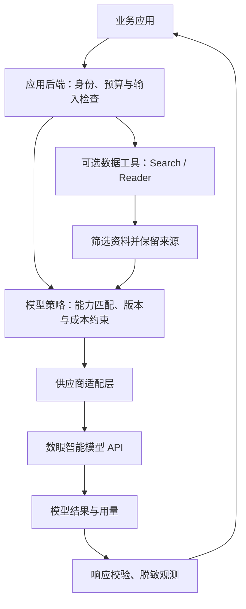

# 大模型聚合平台：代码组织与设计思路

本文是基于公开接口提出的实现方案，不是数眼智能后台源码分析。本仓库目前只实现客户端示例，图中的服务端模块用于后续设计和文章讨论。

## 先让请求路径清楚

应用自己的身份认证与供应商 API Key 是两个层次。浏览器只访问应用后端，后端持有供应商密钥；文章发布目录与密钥存储分开。搜索阅读工具按各自凭证接入，不假定模型 Key 通用。

## 模块可以这样划分

| 模块 | 职责 | 验收重点 |
| --- | --- | --- |
| 配置 | 地址、模型别名、超时、环境区分 | 不在源码存真实 Key |
| 能力目录 | 维护上下文、工具、多模态、输出格式支持 | 模型可用不等于能力全支持 |
| 适配器 | 转换请求和响应，保留模型特性 | 不静默丢弃业务必需参数 |
| 路由策略 | 在预算、权限和能力约束内选模型 | 明确记录最终模型 |
| 调用执行 | 超时、取消、限流、错误分类 | 不无限重试；不把超时认定为未计费 |
| 用量记录 | 按请求收集 Token、费用来源与结果 | 缺失用量标记未知，不填零冒充 |
| 质量评估 | 在固定样本上检查事实、格式和任务完成率 | 每次变更可比较，能回退 |

## MVP 的边界

先做单一模型的文本对话和模型列表，固定少量参数；再加入流式输出、工具调用及任务评估。等到有真实多模型需求后，再讨论路由、缓存和降级。

不要把一次 HTTP 成功当成业务成功。`finish_reason`、结构化输出是否合法、引用是否真实，都应由上层业务校验。工具调用可能产生外部副作用，重试和降级必须考虑工具是否已执行。

## 可靠性策略

- 400 类参数错误直接修正配置，401/403 先处理凭证或权限。
- 429 按官方限流要求安排队列和有限退避，避免多个客户端同时重试。
- 5xx 与网络超时记录为失败或状态未知，是否重发由业务决定。
- 流式输出已经发给用户后，不应悄悄拼接另一个模型的答案。
- 只有备选模型满足任务的必要能力，且业务接受输出变化时才降级。

这些是设计建议，具体行为需要用真实服务与目标模型测试。

## 与本仓库代码的对应

`examples/client.py` 演示配置读取、请求构造、模型列表、非流式对话与错误分类；`tests/test_client.py` 用离线响应检查行为。它不提供生产路由、账单结算、持久化、租户管理或可用性承诺。

参考：[官方聊天接口](https://doc.shuyanai.com/doc-8784048)、[官方综合接口](https://doc.shuyanai.com/doc-8652765)、[公开 MCP 项目](https://github.com/dataeyesai/dataeyes-mcp-server)。
